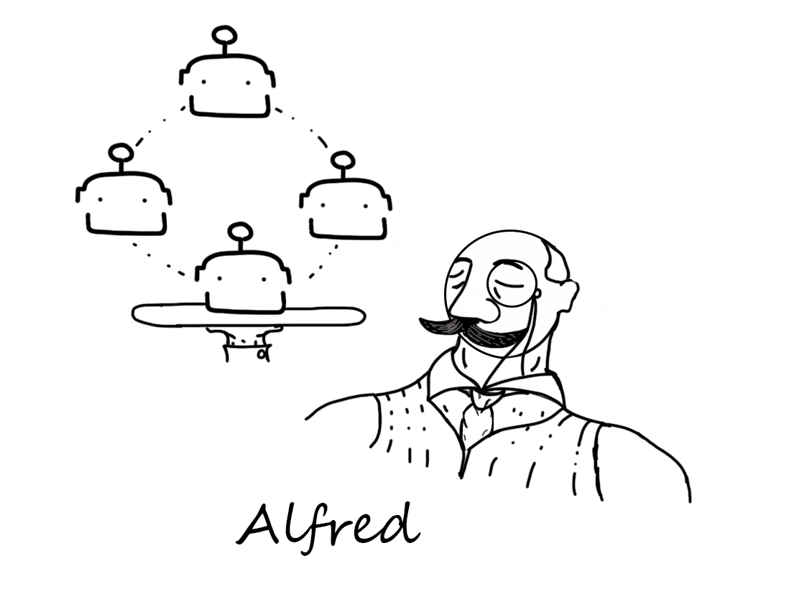
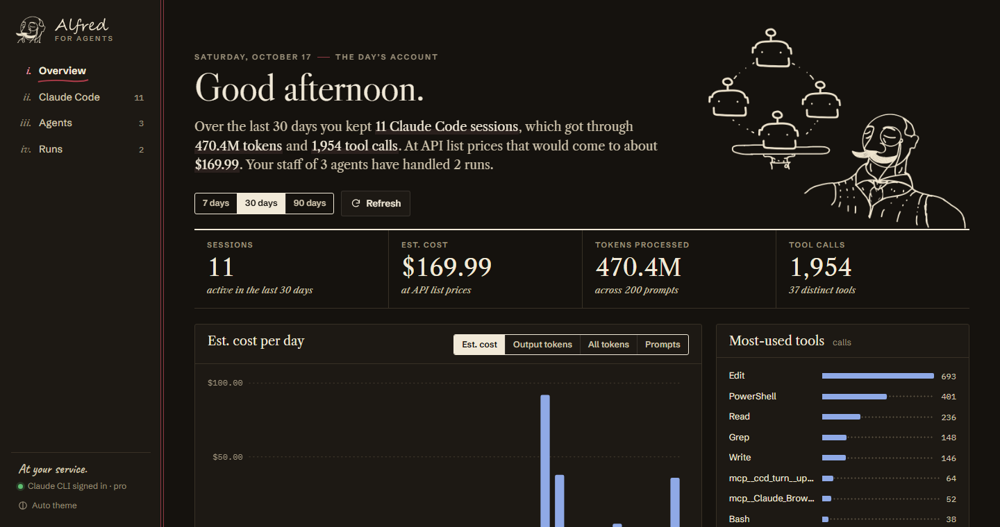
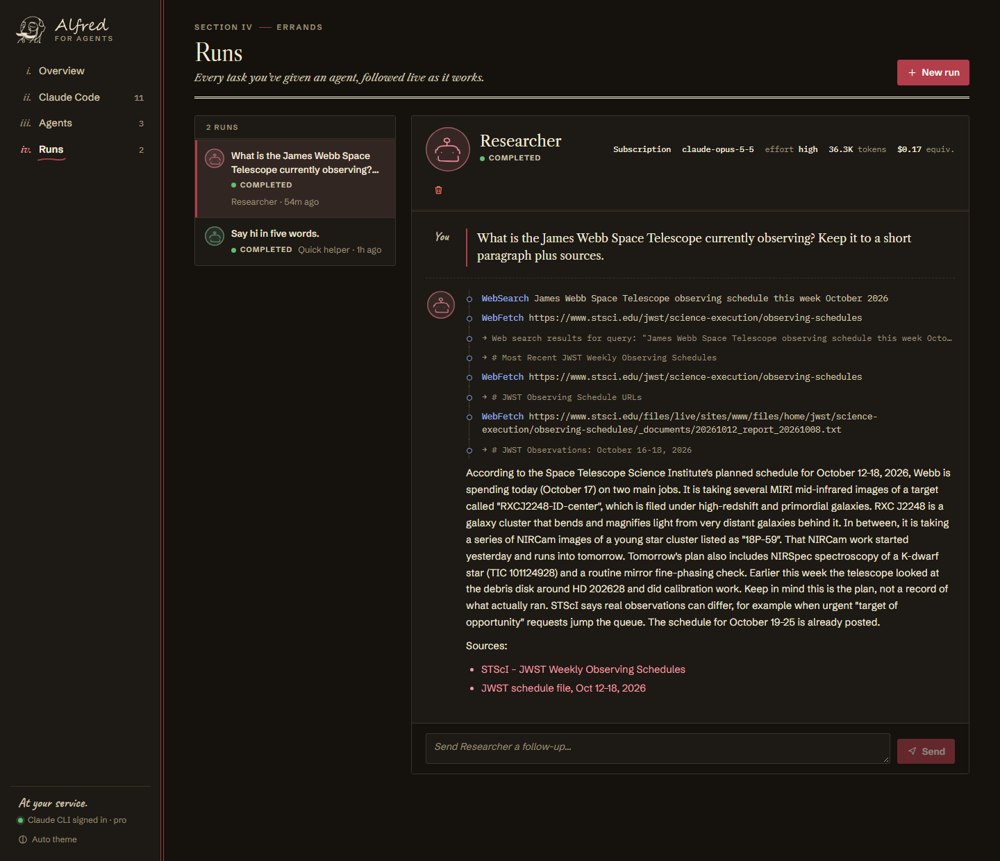
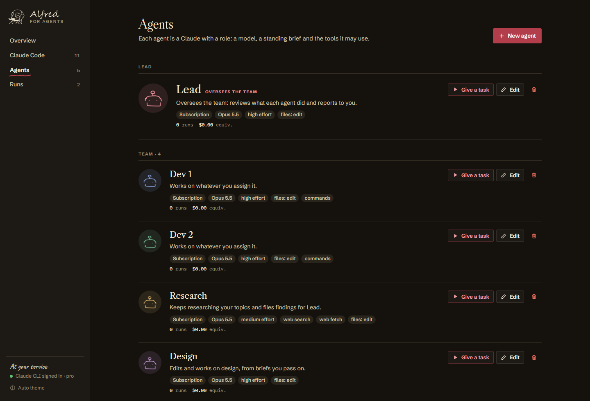
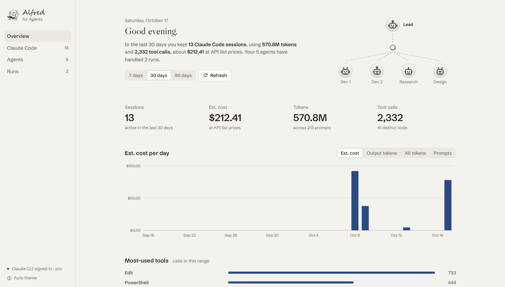
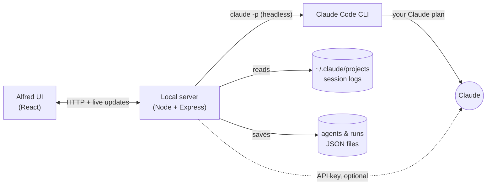

<div align="center">



# Alfred for Agents

**A desktop butler for your Claude agents.**
Build agents, hand them tasks, watch them work live, and keep an eye on everything Claude Code does on your machine, all running on your existing Claude subscription.

[](LICENSE)


[Features](#features) · [Getting started](#getting-started) · [Using Alfred](#using-alfred) · [How it works](#how-it-works) · [FAQ](#faq)

</div>

<br />



## What is Alfred?

Alfred is a local app that does two jobs:

1. **Runs your agents.** An agent is a saved Claude setup: a model, a system prompt, an effort level and the tools it may use. Give one a task and Alfred streams the work as it happens: its thinking, each web search and file read, and the final answer. Then you can send follow-ups, like in a chat.
2. **Watches Claude Code.** Alfred reads the session logs Claude Code already keeps on your computer. It shows what you've been doing: sessions, prompts, tokens, tool calls and what that would cost at API prices.

Agents run through the official **Claude Code CLI**, so they use the Claude Pro or Max plan you already pay for. No API key is needed, and there's no per-token bill. If you'd rather use an API key, you can switch that on for each agent.

Everything stays on your computer. Alfred has no account, server or telemetry of its own.

## Features

<table>
<tr>
<td width="50%" valign="top">

### 🤖 Agents
Save reusable agents with their own model (Opus, Sonnet, Haiku or Fable), system prompt, effort level and tools. Three starter agents are included: **Researcher**, **Code reviewer** and **Quick helper**.

### 🔴 Live runs
Watch a run stream in real time: thinking, tool calls with their results, and the answer with clickable sources. Stop a run, retry it, or keep the conversation going.

</td>
<td width="50%" valign="top">

### 📊 Claude Code monitor
Cost, tokens, prompts and tool calls per day for the last 7, 30 or 90 days. See top tools, every session (searchable and sortable), and a full timeline of each one.

### 🪟 A real desktop app
Alfred gets its own window and a tray icon. When an agent finishes in the background, you get a Windows notification. Alfred can also start with Windows.

### 🎩 A butler, not a dashboard
A calm, single-column design built around the hand-drawn Alfred illustration: Caslon headings, a robot portrait for each agent, an overseer agent shown first, and Day and Evening themes.

</td>
</tr>
</table>





<table>
<tr>
<td width="50%"><p align="center"><sub>Day</sub></p></td>
<td width="50%"><p align="center"><sub>Evening</sub></p></td>
</tr>
</table>

## Getting started

### What you need

| | |
|---|---|
| **Windows 10 or 11** | The desktop app and installer are Windows-only for now (see the [FAQ](#faq) for macOS and Linux). |
| **Claude Code CLI** | Install it with `irm https://claude.ai/install.ps1 \| iex` in PowerShell, or see the [Claude Code docs](https://code.claude.com/docs). |
| **A Claude Pro or Max plan** | Sign the CLI in with `claude auth login`. *Or* use an Anthropic API key instead. |
| **Node.js 22+** | Only needed if you run or build Alfred from source. |

### Option 1: Install the app

1. Download **`Alfred for Agents Setup <version>.exe`** from the [latest release](../../releases/latest).
2. Run it. The installer isn't code-signed yet, so Windows SmartScreen may say *"Windows protected your PC"*: click **More info → Run anyway**.
3. Open **Alfred for Agents** from the Start menu or your desktop.

If the sidebar says *CLI not signed in*, open a terminal and run:

```bash
claude auth login
```

### Option 2: Run it from source

```bash
git clone https://github.com/rt1204-design/alfred-for-agents.git
```

```bash
cd alfred-for-agents
```

```bash
npm install
```

Then pick how you want to run it:

| Command | What it does |
|---|---|
| `npm run app` | Opens Alfred as a desktop app (Electron) |
| `npm run dev` | Browser version with live reload at http://localhost:5173 |
| `npm start` | Builds once and serves the browser version at http://localhost:3001 |
| `npm run dist` | Builds the Windows installer into `release/` |

On Windows you can also double-click **`Start Dashboard.bat`**, which installs dependencies if needed, starts Alfred and opens it in your browser.

## Using Alfred

### Run your first task

1. Go to **Agents** and click **Give a task** on *Quick helper*.
2. Type a task, for example *"Explain what a monad is in two sentences"*, and press **Start run**.
3. Alfred opens the run and streams the answer. Send a follow-up from the box at the bottom.

### Make your own agent

Click **New agent** and set:

| Setting | What it means |
|---|---|
| **Runs on** | *Claude subscription (CLI)* uses your plan through Claude Code. *API key* calls the Claude API directly and bills per token. |
| **Model** | Claude Opus 5.5 is the default. Haiku is fastest and lightest; Fable is the most capable. |
| **Effort** | How hard the model thinks: `low`, `medium`, `high`, `xhigh` or `max`. Higher is slower and uses more of your plan. |
| **System prompt** | The agent's role and how it should work. |
| **Tools** | Web search, web fetch, reading or editing files, running shell commands. Everything is off unless you turn it on. |
| **Working folder** | Where the agent works. Leave it empty for a private folder per agent. |

> [!IMPORTANT]
> Tools you turn on are **pre-approved**: the agent uses them without asking. Anything you didn't turn on is blocked. Only give file-editing or shell access, and only point an agent at a folder, when you trust the agent with it.

### The desktop app

- **Closing the window** keeps Alfred running in the system tray, so runs in progress keep going. Right-click the tray icon to **Quit**.
- **Notifications** pop up when a run finishes while Alfred isn't in front. Click one to jump to that run.
- **Start with Windows** and **Open data folder** are in the tray menu.

## How it works



- **Agent runs.** For subscription agents, Alfred starts `claude -p --output-format stream-json`. It passes the agent's model, effort, system prompt and allowed tools, and streams the CLI's events to the window. Follow-ups resume the same Claude Code session. API-key agents use the official [Anthropic TypeScript SDK](https://github.com/anthropics/anthropic-sdk-typescript) instead.
- **The monitor.** Claude Code writes every session to `~/.claude/projects` as JSONL. Alfred parses those files, which never leave your machine, and totals them by session and by day.
- **The desktop app.** Electron runs the same local server inside the app on a random free port and shows the UI in its own window.

### Where your data lives

| What | Desktop app | From source (browser) |
|---|---|---|
| Agents and run history | `%APPDATA%\Alfred for Agents\data` | `data/` in the project folder |
| Agent working folders | `…\data\workspaces\<agent-id>` | `data/workspaces/<agent-id>` |
| Optional API key (`.env`) | `%APPDATA%\Alfred for Agents\.env` | `.env` in the project folder (see `.env.example`) |

Runs started by Alfred also show up on the **Claude Code** page, named *"Alfred: &lt;agent&gt;"*.

### Settings

Put these in the `.env` file:

| Variable | Purpose |
|---|---|
| `ANTHROPIC_API_KEY` | Needed only for agents set to *API key*. |
| `CLAUDE_BIN` | Full path to the `claude` executable, if Alfred can't find it. By default it checks your PATH, then `~/.local/bin`, then the copy bundled with the Claude desktop app. |
| `CLAUDE_PROJECTS_DIR` | Read Claude Code logs from somewhere other than `~/.claude/projects`. |
| `PORT` | Port for the browser version (default `3001`). |

## Security

- **Your Claude login stays with the Claude Code CLI.** Alfred never sees or stores your Claude credentials; it starts the `claude` program, which uses whatever account you signed it in with. Each person who installs Alfred signs in with their own account.
- **Local only.** Alfred's server listens on `127.0.0.1`, so other devices on your network can't reach it. It also rejects requests addressed to any other host name or sent from other websites, which blocks DNS-rebinding and cross-site attacks from pages open in your browser, and stops websites from detecting that Alfred is running.
- **Tested.** `npm test` checks these defences, and the app has been through an adversarial test. The findings and fixes are in the release notes.
- **Tools are opt-in and pre-approved.** An agent can only use the tools you turn on, and it uses them without asking. Don't give one agent both **web access** and **shell or file-edit access**: text on a web page could try to steer it into running commands.
- **Agents don't inherit extra powers.** Agent runs ignore MCP servers from your Claude Code config, and ignore any Claude Code settings or hooks inside the agent's working folder, so pointing an agent at a downloaded project can't make it run that project's hooks. A `CLAUDE.md` in the working folder is still read as instructions, as Claude Code always does. It can't unlock tools you didn't turn on, but it can steer how an agent uses the ones it has, so check `CLAUDE.md` files in folders you didn't write.
- **Hardened desktop app.** The window runs sandboxed with no Node.js access, denies camera/microphone/location requests, and only opens `http(s)` links in your browser. The executable has Electron's "run as Node" and debugging switches turned off and checks its own app files for tampering.
- **API keys** (optional) stay in your local `.env` file and are only sent to Anthropic.

Found a security problem? Please open an issue, or contact the maintainer privately for anything sensitive.

## Project structure

```
alfred-for-agents/
├── electron/main.js       Desktop shell: window, tray, notifications
├── server/
│   ├── index.js           Express API and static file server
│   ├── agents.js          Agents, runs, and the CLI and API runners
│   ├── claudeCli.js       Finds the Claude Code CLI and checks sign-in
│   ├── claudeCode.js      Parses Claude Code session logs
│   └── pricing.js         Per-model prices for cost estimates
├── src/                   React UI (Vite)
├── assets/alfred.png      The Alfred illustration
├── public/art/            Line-art pieces cut from the illustration
├── build/                 App and tray icons (made by `npm run icon`)
└── scripts/
    ├── make-icon.mjs      Builds the icons from Alfred's head
    └── make-art.mjs       Cuts the illustration into the UI's art pieces
```

## FAQ

<details>
<summary><b>Does this cost extra?</b></summary>
<br />
Not for subscription agents: they count against your Claude Pro or Max usage limits the same way Claude Code does. Costs shown with <i>"equiv."</i> are what the same work would cost at API prices, for comparison only. Agents set to <i>API key</i> are billed per token by Anthropic.
</details>

<details>
<summary><b>Does it work on macOS or Linux?</b></summary>
<br />
The installer is Windows-only, and Alfred has only been tested on Windows 11. Running from source (<code>npm run dev</code> or <code>npm run app</code>) should work wherever Node.js and the Claude Code CLI do, but it hasn't been tested there. Pull requests are welcome.
</details>

<details>
<summary><b>"Claude Code CLI not found" or "not signed in"</b></summary>
<br />
Install the CLI, then run <code>claude auth login</code> in a terminal and refresh Alfred. If <code>claude</code> lives somewhere unusual, set <code>CLAUDE_BIN</code> to its full path.
</details>

<details>
<summary><b>Windows says the installer isn't safe</b></summary>
<br />
The installer isn't code-signed, so SmartScreen warns about it. Click <b>More info → Run anyway</b>, or build it yourself with <code>npm run dist</code>.
</details>

<details>
<summary><b>Is the cost on the Overview page what I actually paid?</b></summary>
<br />
No. It's an estimate at API list prices, worked out from the token counts in your Claude Code logs. If you use Claude Code on a subscription, you aren't billed per token.
</details>

## Contributing

Issues and pull requests are welcome. To work on Alfred, run `npm run dev` for the browser version with live reload, or `npm run app` for the desktop app. If you change the drawing, `npm run icon` rebuilds every icon and `node scripts/make-art.mjs` re-cuts the UI art from `assets/alfred.png`.

## License

[MIT](LICENSE). Alfred is not affiliated with or endorsed by Anthropic. Claude and Claude Code are trademarks of Anthropic.

<div align="center">
<br />
<br />
<sub>Illustration and icon by the author.</sub>
</div>
